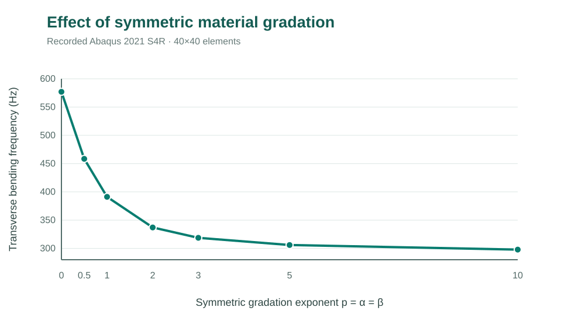
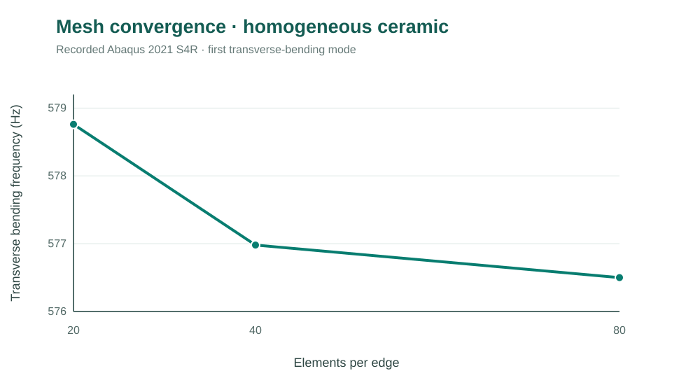
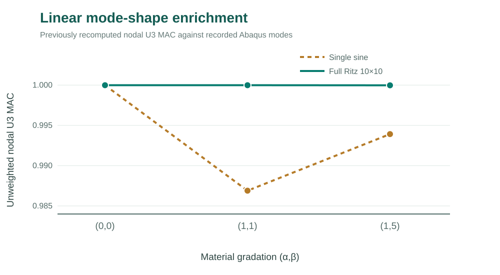
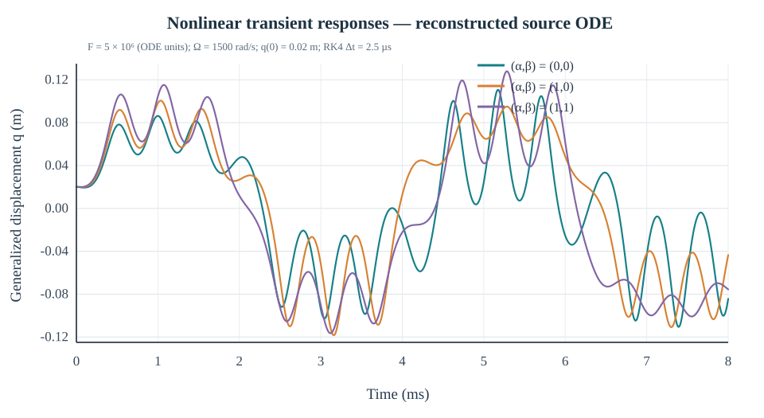
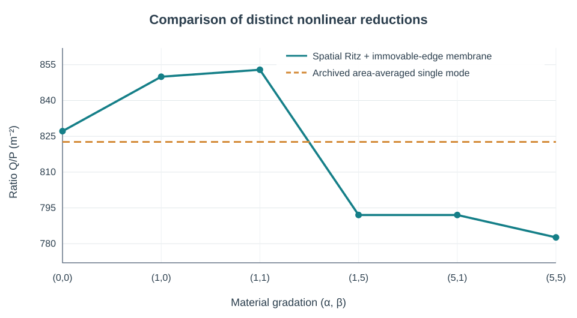

# Linear and Nonlinear Vibration of Bidirectionally Functionally Graded Plates

**Mehdi Soroush** · Computational Solid Mechanics and Structural Dynamics  
**Research:** 2018–2020 · **Computational development and verification:** 2026  
**Software:** v0.1 linear benchmark · v0.2 nonlinear development

## Overview

This project investigates the free and geometrically nonlinear vibration of in-plane bidirectionally functionally graded plates. Its analytical and computational framework combines nonlinear plate mechanics, Rayleigh–Ritz approximation, reduced-order modelling, numerical time integration, and finite-element verification.

The 2018–2020 research established the nonlinear analytical formulation. The Python implementations, Abaqus postprocessing, reproducible benchmarks, and spatially resolved nonlinear extension were developed in 2026.

## Research contributions

- **Analytical nonlinear vibration:** von Kármán kinematics, Airy stress function, Galerkin reduction, perturbation methods, and numerical response calculations.
- **Linear Ritz solver:** variable-coefficient Kirchhoff–Love plate model, double-sine basis, Gauss–Legendre integration, and generalized eigenvalue analysis.
- **Finite-element benchmarks:** Abaqus 2021 S4R model generation, mesh and thickness studies, material-gradation sweeps, and displacement export.
- **Modal correlation:** nodal U3 modal assurance criterion (MAC), comparing single-sine approximations and enriched 10×10 Ritz eigenvectors with Abaqus results.
- **Nonlinear time-domain model:** reconstruction of six recorded single-mode coefficient cases and an undamped cubic oscillator, with conservative period and energy checks.
- **Spatial nonlinear extension:** variational von Kármán reduction with in-plane membrane-energy condensation and immovable in-plane edges.

## Physical system

The baseline plate has \(a=b=0.8\,\mathrm{m}\), \(h=0.04\,\mathrm{m}\), and the bidirectional ceramic fraction

\[
V_c(x,y)=\left(\frac{x}{a}\right)^\alpha\left(\frac{y}{b}\right)^\beta.
\]

The effective properties are

\[
E=E_{\rm Al}+(E_c-E_{\rm Al})V_c,\qquad
\rho=\rho_{\rm Al}+(\rho_c-\rho_{\rm Al})V_c.
\]

| Property | Alumina (Al₂O₃) | Aluminum |
|:--|--:|--:|
| Young's modulus | 380 GPa | 70 GPa |
| Density | 3800 kg/m³ | 2700 kg/m³ |
| Poisson ratio | 0.30 | 0.30 |

The (0,0) case is the homogeneous ceramic limit. The constitutive model employs idealized effective properties rather than experimentally calibrated microstructure parameters.

## Linear modal benchmarks

| Gradation (α, β) | Ritz 10×10 (Hz) | Abaqus S4R 40×40 (Hz) |
|:--|--:|--:|
| (0,0) | 594.18074 | 576.98 |
| (1,1) | 402.57036 | 391.20 |
| (5,5) | 316.53602 | 305.98 |
| (1,5) | 334.65096 | 323.58 |
| (5,1) | 334.65096 | 323.58 |

The homogeneous Abaqus transverse-bending frequency changes from **576.98 Hz** at 40×40 to **576.50 Hz** at 80×80 (−0.083%). The classical Ritz–S4R frequency difference decreases with thickness, consistent with the different plate kinematics; individual shear and rotary-inertia contributions have not been isolated.

### Mode-shape correlation

| Gradation | Single-sine MAC | Full 10×10 Ritz MAC |
|:--|--:|--:|
| (0,0) | 0.99998717 | 0.99998717 |
| (1,1) | 0.98689444 | 0.99998642 |
| (1,5) | 0.99391837 | 0.99997379 |

The correlations use the versioned Abaqus transverse-displacement datasets in **data/abaqus_u3/**. Enriching the Ritz basis substantially improves agreement for the graded plates.

## Nonlinear vibration models

### Analytical single-mode reduction

The analytical model is represented by the undamped cubic equation

\[
\ddot q+Pq+Qq^3=F\sin(\Omega t).
\]

The Python implementation reproduces six recorded \(P,Q\) coefficient pairs. Numerical checks cover time integration, conservative mechanical energy, and the exact free-oscillator period integral. For the baseline square plate, the original area-averaged reduction yields \(Q/P=822.65625\,\mathrm{m}^{-2}\) across its gradation cases.

[Analytical coefficients and notebook correspondence](docs/nonlinear_source_audit.md) · [Reduced oscillator formulation](docs/nonlinear_model.md)

### Spatially graded variational reduction

A separate von Kármán formulation retains the spatially varying material law and minimizes the membrane energy over interior in-plane Ritz functions with \(u=v=0\) along all edges. With the transverse mode normalized at the plate centre,

\[
M\ddot q+K_bq+2Cq^3=0,\qquad
C=C_0-\mathbf f_m^{\mathsf T}\mathbf K_m^{-1}\mathbf f_m.
\]

A 10×10 transverse Ritz basis, 8×8 in-plane basis per displacement component, and 48×48 quadrature give:

| Gradation | Linear Ritz frequency (Hz) | Spatial \(Q/P\) (m⁻²) |
|:--|--:|--:|
| (0,0) | 594.18074 | 827.15 |
| (1,0) | 477.31102 | 849.97 |
| (1,1) | 402.57036 | 852.88 |
| (1,5) | 334.65096 | 792.03 |
| (5,5) | 316.53602 | 782.64 |

The spatial model gives a gradation-dependent nonlinear-to-linear stiffness ratio. Its constitutive approximation, mode enrichment, and in-plane supports differ from the area-averaged single-mode formulation, so the two sets of coefficients are compared as distinct models rather than a matched validation study.

[Variational derivation and numerical study](docs/nonlinear_variational_extension.md) · [Equation-consistency analysis](docs/source_equation_consistency.md)

## Reproduce the calculations

The modern numerical code requires **Python 3.10+**. New Abaqus solver runs require an Abaqus license; analysis of the recorded CSV datasets does not.

~~~bash
python -m venv .venv
python -m pip install -e '.[test]'
python -m pytest -q

python scripts/run_ritz.py
python scripts/compare_fem.py
python scripts/make_figures.py
python scripts/reproduce_nonlinear_transients.py
python scripts/sweep_spatial_nonlinear.py
~~~

On Windows, activate the environment using **.venv\Scripts\Activate.ps1**. See [Abaqus instructions](abaqus/README.md) for the Python 2.7-compatible model generator and displacement exporter.

## Verification and limitations

| Research component | Evidence |
|:--|:--|
| Linear Kirchhoff–Love plate model | Executable Ritz solver; homogeneous reference, thickness, and coordinate-symmetry tests |
| Linear Abaqus comparison | Recorded eigenfrequencies, mesh studies, U3 displacement datasets, and nodal MAC comparisons |
| Analytical cubic oscillator | Six source-coefficient regressions, numerical transient integration, period integral, and energy conservation |
| Spatial nonlinear plate reduction | Variational formulation, membrane condensation, convergence, symmetry, and scaling checks |

The recorded Abaqus benchmarks concern **linear free vibration**. The nonlinear plate results are based on reduced-order models; a matched-boundary-condition geometrically nonlinear Abaqus comparison is the next verification stage. The project is analytical and computational and does not contain experimental data. The forcing coefficient in the 2018–2020 oscillator is retained in its numerical normalization pending a physical load-projection comparison.

[Linear verification](docs/verification.md) · [Research provenance](docs/provenance.md) · [Roadmap](ROADMAP.md)

## Repository structure

~~~text
src/fgm_plate/       Material, Ritz, modal and nonlinear Python models
abaqus/              Abaqus 2021 model generation and U3 export
scripts/             Reproduction and figure-generation commands
data/reference/      Numerical benchmarks and coefficient tables
data/abaqus_u3/      Recorded Abaqus displacement datasets
tests/               Automated regression checks
results/figures/     Scientific plots and modal visualizations
docs/                Mathematical formulations and technical report
.github/workflows/   Continuous integration on Python 3.11 and 3.12
~~~

The [independent technical research report](docs/FGM_Independent_Technical_Research_Report.pdf) documents the analytical study and linear verification. The additional 2026 spatially graded nonlinear reduction is documented separately.

## Citation and license

**Mehdi Soroush** · Analytical research: 2018–2020 · Computational development: 2026. Citation metadata are in [CITATION.cff](CITATION.cff).

Project code and documentation are distributed under the [MIT License](LICENSE). Third-party publications retain their respective copyright terms.
